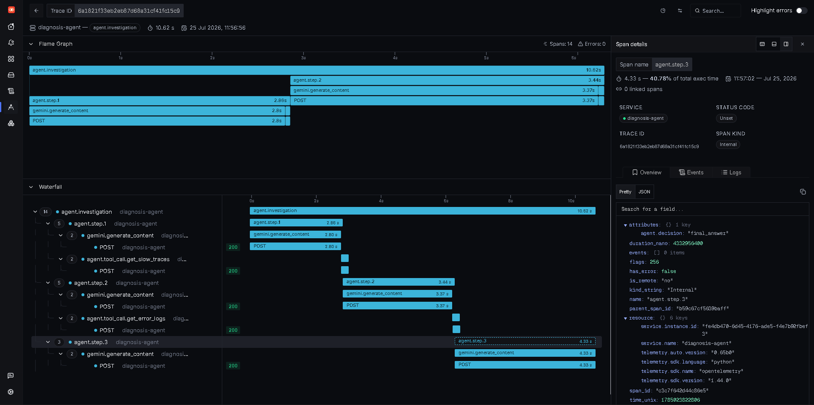

# 🩺 AI SRE Agent

### From incident detection to evidence-based diagnosis.

**AI SRE Agent** is an AI-powered Site Reliability Engineering tool that investigates microservice failures using live observability data from SigNoz. Powered by Google's Gemini API and instrumented with OpenTelemetry, it gathers evidence from logs and distributed traces, dynamically chooses what to investigate next, and produces a human-readable diagnosis with recommended next steps.

Instead of simply showing you another dashboard, it helps answer the question: **What went wrong, and where should we look next?**

[](https://www.python.org/)
[](https://fastapi.tiangolo.com/)
[](https://opentelemetry.io/)
[](https://signoz.io/)
[](https://ai.google.dev/)

**Built for the Agents of SigNoz Hackathon · AI & Agent Observability**

[Project write-up](https://dev.to/polikeybhuvan/i-built-an-ai-sre-agent-that-doesnt-just-detect-incidents-it-investigates-them-2l01) · [Report an issue](https://github.com/polikeybhuvan/signoz-ai-sre-agent/issues)

---

## 📌 Table of Contents

- [Overview](#-overview)
- [Features](#-features)
- [Architecture](#-architecture)
- [How the Agent Works](#-how-the-agent-works)
- [Observing the Observer](#-observing-the-observer)
- [Demo Results](#-demo-results)
- [Technology Stack](#-technology-stack)
- [Getting Started](#-getting-started)
- [Project Structure](#-project-structure)
- [Limitations](#-limitations)
- [Roadmap](#-roadmap)
- [Contributing](#-contributing)

## 🔍 Overview

Observability platforms help engineers detect errors, latency spikes, and service degradation. Diagnosing the underlying cause, however, often requires manually inspecting traces, correlating logs, forming hypotheses, and deciding what evidence to investigate next.

**AI SRE Agent automates the first pass of that investigation.**

The project combines a deliberately failure-prone microservices application with an AI agent that queries SigNoz for evidence. Using Gemini function calling, the agent selects diagnostic tools, evaluates their results, and can request more evidence before producing a diagnosis.

The diagnostic agent is itself instrumented with OpenTelemetry. Its investigation steps, LLM requests, tool executions, latency, and token usage can be inspected in SigNoz.

The goal is to reduce repetitive initial investigation and help engineers reach a useful starting hypothesis faster—not to replace human judgment.

## ✨ Features

- **Dynamic AI investigation:** Gemini selects diagnostic tools based on the evidence it needs.
- **Live observability queries:** Retrieves slow traces, error logs, and traces containing errors from SigNoz.
- **Microservice failure simulation:** Four FastAPI services simulate latency, transaction failures, downstream errors, and malformed AI responses.
- **AI observability:** OpenTelemetry spans expose the diagnostic agent's execution path.
- **Token and latency tracking:** Records Gemini usage metadata when returned by the API and measures execution timing.
- **Continuous monitoring prototype:** Periodically checks error traces and triggers an investigation when a configured threshold is reached.
- **Human-readable diagnosis:** Explains likely problems and recommends a concrete next step.
- **Read-only investigation:** Collects evidence and recommends actions without automatically modifying or remediating systems.

## 🏗️ Architecture

```text
                     Checkout Traffic
                            |
                            v
                 +----------------------+
                 |  Frontend Service    |
                 |      Port 8001       |
                 +----------+-----------+
                            |
                            v
                 +----------------------+
                 |    Order Service     |
                 |      Port 8002       |
                 +-----+-----------+----+
                       |           |
                       v           v
            +----------------+ +----------------+
            | Inventory      | | Simulated AI   |
            | Service :8003  | | Service :8004  |
            +----------------+ +----------------+
                       |
                       v
             Application Telemetry
                       |
                       v
                +-------------+
                |    SigNoz   |
                | Logs/Traces |
                +------+------+
                       ^
                       |
                 Query API
                       |
                +------+------+
                | AI SRE Agent|
                | Gemini +    |
                | 3 Tools     |
                +------+------+
                       |
                       v
             Diagnosis and Next Steps
```

The application services generate telemetry that is exported to SigNoz through OpenTelemetry. The diagnostic agent queries SigNoz, uses Gemini to decide which evidence to inspect, and produces a diagnosis. The agent's own execution is instrumented as well.

### Microservices

| Service | Port | Responsibility | Simulated failures |
|---|---:|---|---|
| `frontend_service.py` | 8001 | Receives checkout requests and calls the order service. | Downstream failures and HTTP errors |
| `order_service.py` | 8002 | Coordinates inventory checks and the simulated AI call. | Random delays, transaction failures, and downstream errors |
| `inventory_service.py` | 8003 | Simulates an inventory database lookup. | Query latency and connection-pool exhaustion |
| `agent_service.py` | 8004 | Simulates an application's AI dependency. | Slow responses and malformed response structures |

The simulated AI service is part of the application under test. It is different from the real Gemini-powered diagnostic agent.

## 🧠 How the Agent Works

The diagnostic agent is implemented in `agent_diagnose.py`. It uses Gemini function calling and exposes three read-only tools.

| Tool | Purpose |
|---|---|
| `get_slow_traces()` | Retrieves the slowest root-level traces within a lookback window. |
| `get_error_logs()` | Retrieves recent error-level logs, optionally filtered by service. |
| `get_error_traces()` | Retrieves traces containing error spans. |

### Investigation workflow

1. **Investigate:** Gemini receives the investigation objective and available tool definitions.
2. **Select:** The model chooses a tool and supplies its arguments.
3. **Collect:** Python executes the tool against the SigNoz query API.
4. **Evaluate:** Tool results are returned to Gemini for interpretation.
5. **Continue or diagnose:** Gemini can request additional evidence or produce a final diagnosis.

The investigation is bounded by a configurable maximum number of steps, preventing an unbounded tool-calling loop.

### Example investigation

Imagine a checkout request that takes several seconds to complete.

1. **Identify the symptom:** Slow traces reveal unusually long checkout requests.
2. **Narrow the investigation:** Error logs suggest that the frontend is waiting on an unsuccessful order-service request.
3. **Recommend the next step:** The agent identifies the order service or one of its downstream dependencies as a likely cause and recommends inspecting related error traces.

This is an illustrative investigation path, not a guaranteed sequence. The actual tool calls depend on the telemetry returned and the model's decisions.

The output is an LLM-generated diagnosis, not definitive proof of root cause. Engineers should validate the supporting evidence before acting.

## 🔭 Observing the Observer

A central design principle of this project is that the AI investigation itself should be observable.

OpenTelemetry spans represent the overall investigation, individual reasoning steps, Gemini requests, and tool executions.

```text
agent.investigation
├── agent.step.1
│   └── gemini.generate_content
├── agent.tool_call.get_slow_traces
├── agent.step.2
│   └── gemini.generate_content
├── agent.tool_call.get_error_logs
└── agent.step.3
    └── gemini.generate_content
```

The actual span tree depends on the investigation path and number of tool calls.

The implementation records attributes such as:

- LLM provider and requested model
- Prompt, completion, and total token usage when returned by Gemini
- Investigation step and agent decision
- Tool names, arguments, and result counts
- Execution timing for LLM requests and tools

This helps investigate both application failures and the diagnostic agent's execution, latency, and token consumption.

## 📊 Demo Results

The repository's documented demonstration reported the following results from an end-to-end load test captured in SigNoz.

| Measurement | Reported result |
|---|---:|
| Checkout requests | 195 |
| Successful requests | 158 |
| Failed requests | 37 |
| Success rate | 81.03% |
| Investigation steps | 3 |
| Tool calls | 2 |
| Investigation duration | Approximately 10.6 seconds |
| Investigation trace spans | 14 |
| Errors in the recorded investigation trace | 0 |

The recorded trace showed that the final synthesis step accounted for approximately 40.78% of the total investigation duration.

These are reported results from the documented demonstration, not guaranteed performance benchmarks. Actual results vary with simulated failures, available telemetry, network conditions, and LLM response times.

### Investigation trace



*Recorded SigNoz trace showing the diagnostic agent's execution and timing breakdown.*

## 🧰 Technology Stack

| Technology | Role |
|---|---|
| Python | Application and agent implementation |
| FastAPI | Microservice APIs |
| HTTPX | HTTP communication between services and load generation |
| Gemini API | LLM reasoning and function calling |
| SigNoz | Observability queries and telemetry visualization |
| OpenTelemetry | Distributed tracing and agent instrumentation |
| Requests | HTTP requests to SigNoz and Gemini |
| python-dotenv | Loading local environment variables |

## 🚀 Getting Started

### Prerequisites

Before running the project, prepare:

- Python 3.10 or later
- A running SigNoz instance with its query API accessible
- A Gemini API key from [Google AI Studio](https://aistudio.google.com/)
- Git and a terminal
- An accessible OTLP endpoint for sending telemetry to SigNoz

The steps below run the application services as local Python processes. SigNoz can be deployed separately, including through Docker.

### 1. Clone the repository

```bash
git clone https://github.com/polikeybhuvan/signoz-ai-sre-agent.git
cd signoz-ai-sre-agent
```

### 2. Create and activate a virtual environment

**Windows — Command Prompt**

```bat
python -m venv venv
venv\Scripts\activate
```

**macOS / Linux**

```bash
python3 -m venv venv
source venv/bin/activate
```

### 3. Install dependencies

```bash
python -m pip install --upgrade pip
python -m pip install -r requirements.txt
opentelemetry-bootstrap -a install
```

### 4. Configure environment variables

Create a local `.env` file in the repository root by copying `.env.example`.

**Windows — Command Prompt**

```bat
copy .env.example .env
```

**macOS / Linux**

```bash
cp .env.example .env
```

Edit `.env` locally and configure your credentials:

```dotenv
SIGNOZ_URL=http://localhost:8080
SIGNOZ_API_KEY=YOUR_SIGNOZ_API_KEY
GEMINI_API_KEY=YOUR_GEMINI_API_KEY
GEMINI_MODEL=gemini-2.5-flash
MAX_AGENT_STEPS=5
LOOKBACK_MINUTES=15
```

Replace the placeholders with valid credentials. Adjust the SigNoz URL and model settings to match your environment.

**Security essentials**

- Never commit `.env` or real credentials to GitHub.
- Keep `.env.example` free of secrets.
- Rotate credentials that have been exposed.
- Ensure `.env` is excluded by `.gitignore`.
- If credentials were committed previously, rotate them and remove them from Git history as appropriate. Removing them from the latest file alone does not remove them from earlier commits.

### 5. Start SigNoz and the microservices

Ensure SigNoz is running and that its query API and OTLP endpoint are accessible.

Open a separate terminal for each microservice. Activate your virtual environment in each terminal and set the OpenTelemetry endpoint and service name before starting the process.

The following examples use Windows Command Prompt. Adjust the OTLP endpoint to match your SigNoz deployment.

**Frontend service**

```bat
set OTEL_EXPORTER_OTLP_ENDPOINT=http://localhost:4317
set OTEL_SERVICE_NAME=frontend-service
opentelemetry-instrument python frontend_service.py
```

**Order service**

```bat
set OTEL_EXPORTER_OTLP_ENDPOINT=http://localhost:4317
set OTEL_SERVICE_NAME=order-service
opentelemetry-instrument python order_service.py
```

**Inventory service**

```bat
set OTEL_EXPORTER_OTLP_ENDPOINT=http://localhost:4317
set OTEL_SERVICE_NAME=inventory-service
opentelemetry-instrument python inventory_service.py
```

**Simulated AI service**

```bat
set OTEL_EXPORTER_OTLP_ENDPOINT=http://localhost:4317
set OTEL_SERVICE_NAME=agent-service
opentelemetry-instrument python agent_service.py
```

Keep each service running in its own terminal. Ensure the ports and endpoints match your local setup.

### 6. Generate checkout traffic

Open another terminal and run:

```bash
python load_test.py
```

The load generator repeatedly sends checkout requests. The simulated services introduce variable latency and occasional failures, generating telemetry for SigNoz to collect.

Allow some traffic to accumulate before running the diagnostic agent.

### 7. Run the AI SRE agent

Open another terminal, activate the virtual environment, and execute:

```bat
set OTEL_EXPORTER_OTLP_ENDPOINT=http://localhost:4317
set OTEL_SERVICE_NAME=diagnosis-agent
opentelemetry-instrument python agent_diagnose.py
```

The agent queries SigNoz, asks Gemini to select investigation tools, executes those tools, and prints the resulting diagnosis.

The earlier fixed-query diagnostic workflow can be run separately:

```bash
python diagnose.py
```

### 8. Run the monitoring prototype

The project includes `monitor.py`, a continuous monitoring loop that periodically checks error traces.

```bat
set OTEL_EXPORTER_OTLP_ENDPOINT=http://localhost:4317
set OTEL_SERVICE_NAME=diagnosis-agent
opentelemetry-instrument python monitor.py
```

The current configuration:

- Checks every 60 seconds
- Searches a five-minute lookback window
- Triggers an investigation when at least three distinct returned trace IDs are found
- Applies a three-minute cooldown after a trigger
- Handles investigation and alert-log write failures without intentionally terminating the monitoring loop

**Monitoring limitation:** The current diagnostic tool returns a limited set of error-trace rows. Deduplication improves counting accuracy for the returned results, but traces beyond that result window may not be considered. This remains a prototype, not a production alert-management system.

## 📁 Project Structure

```text
signoz-ai-sre-agent/
├── frontend_service.py   # Checkout entry point
├── order_service.py      # Order orchestration and injected failures
├── inventory_service.py  # Inventory and database-failure simulation
├── agent_service.py      # Simulated AI dependency
├── agent_diagnose.py     # Gemini-powered diagnostic agent
├── diagnose.py           # Fixed-query diagnostic workflow
├── monitor.py            # Continuous monitoring prototype
├── json_logger.py        # Structured JSON logging
├── load_test.py          # Checkout traffic generator
├── requirements.txt      # Python dependencies
├── .env.example          # Safe configuration template
├── .gitignore            # Excludes local secrets and generated files
├── SECURITY.md           # Security policy
├── trace-waterfall.png   # Recorded SigNoz investigation trace
└── README.md
```

The real `.env` file belongs only in your local environment or an appropriately secured deployment environment. It should never be committed to the repository.

## ⚠️ Limitations

This project is a prototype intended for learning, experimentation, and demonstration.

- The diagnostic tools query logs and traces; a dedicated metrics-investigation tool is not yet implemented.
- The microservices use randomized failure injection rather than a production database or real external AI dependency.
- LLM diagnoses can be incomplete or incorrect and require engineer validation.
- Monitoring relies on a basic threshold and cooldown, with a limited set of trace results.
- The agent recommends next steps but does not automatically remediate incidents.
- Successful operation depends on accessible SigNoz telemetry, valid credentials, network connectivity, and Gemini API availability.
- The application has not been independently validated as a production-ready system.

## 🗺️ Roadmap

- [ ] Improve monitoring completeness, pagination, and exception recovery.
- [ ] Add more reproducible failure scenarios.
- [ ] Generate structured incident reports with supporting evidence.
- [ ] Add metrics analysis and service-level objective context.
- [ ] Explore integrating the SigNoz MCP server instead of handwritten query tools.
- [ ] Evaluate multi-agent investigation across logs, traces, and metrics.
- [ ] Add automated tests and continuous integration.
- [ ] Package the services for reproducible deployment.
- [ ] Evaluate diagnosis quality against known failure scenarios.

## 💡 What I Learned

Building this project reinforced that an effective AI agent needs more than an LLM and a prompt. It needs useful tools, reliable telemetry, realistic failure scenarios, bounded execution, and visibility into its own behavior.

Working through service networking, SigNoz setup, OpenTelemetry configuration, and telemetry queries also showed how much real-world SRE work involves infrastructure and evidence gathering—not simply interpreting error messages.

**The central idea: make the investigation observable, not just the incident.**

## 🤝 Contributing

Bug reports, suggestions, and contributions are welcome.

For substantial changes, open an issue first to discuss the proposed work.

---

<p align="center">

**Built solo for the Agents of SigNoz Hackathon · AI & Agent Observability**

If you find this project interesting, consider starring the repository.

[View on GitHub](https://github.com/polikeybhuvan/signoz-ai-sre-agent)

</p>
